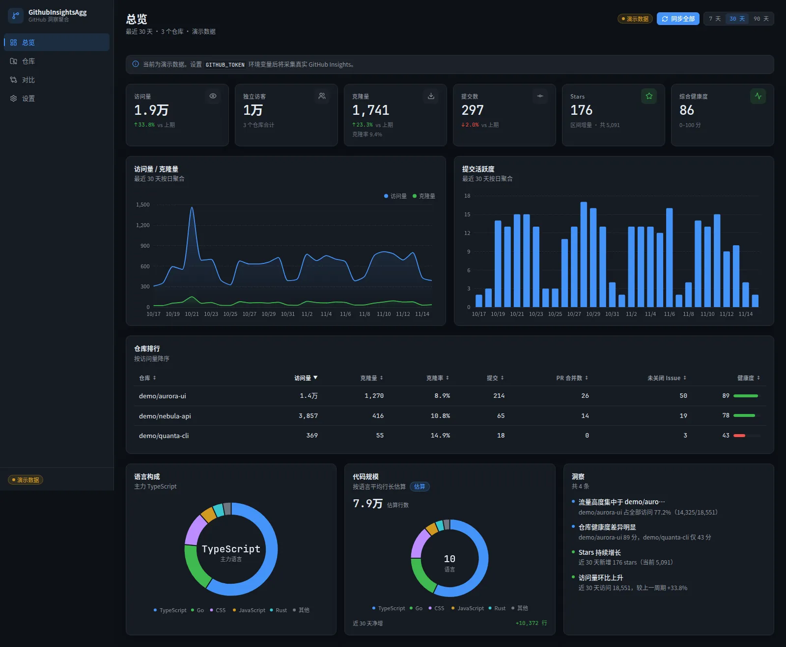
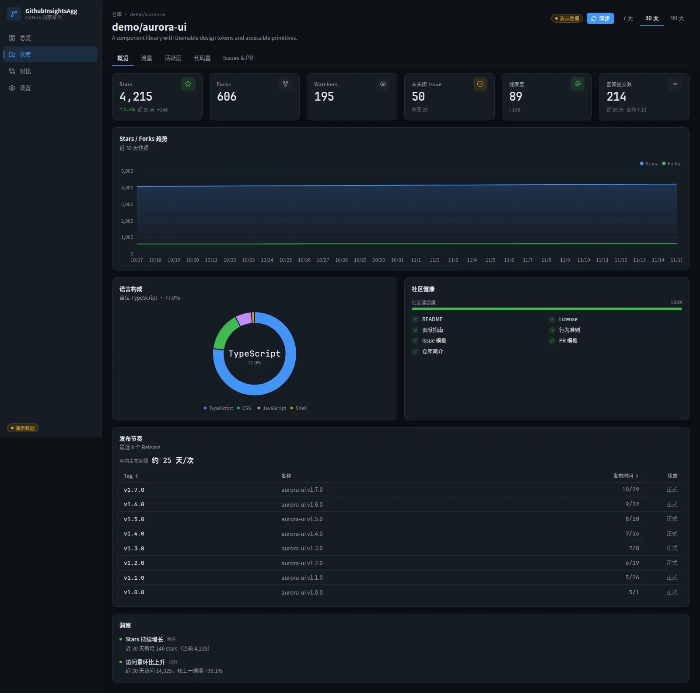
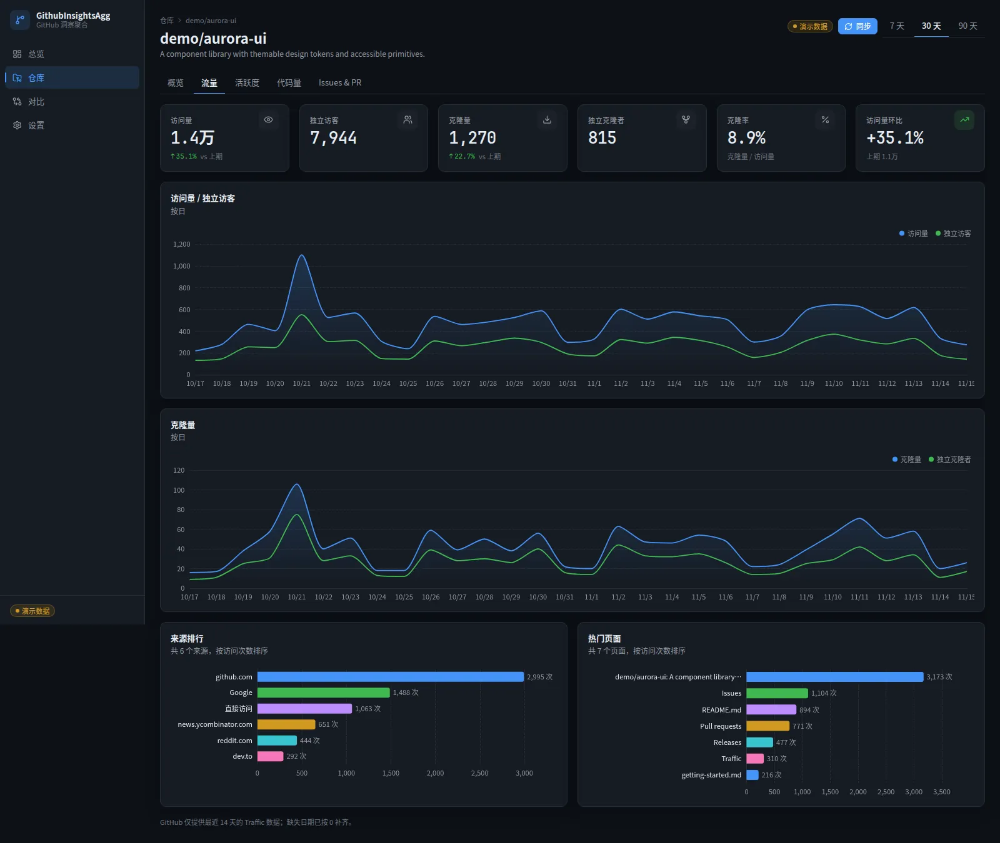
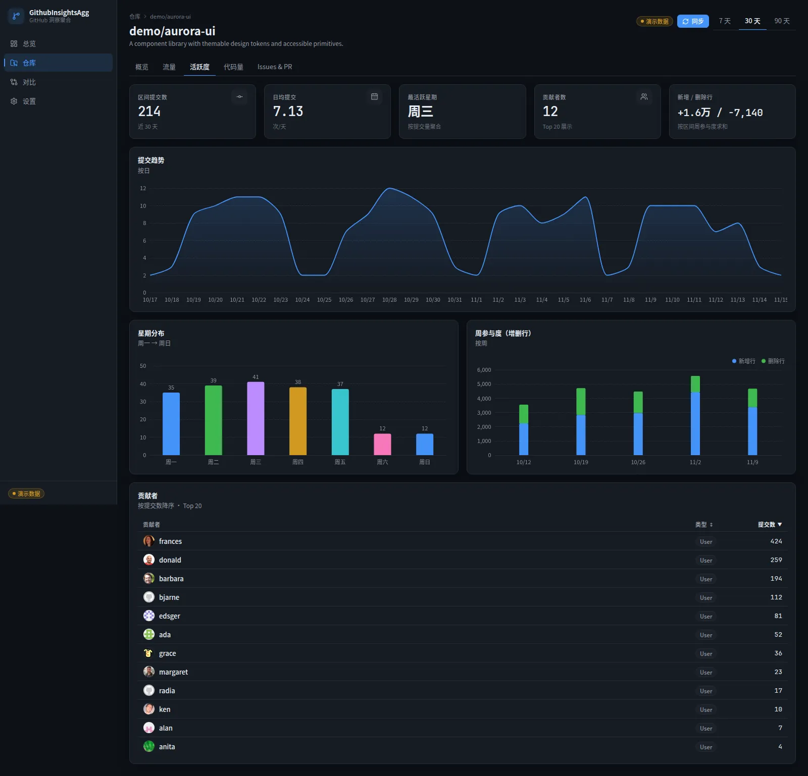
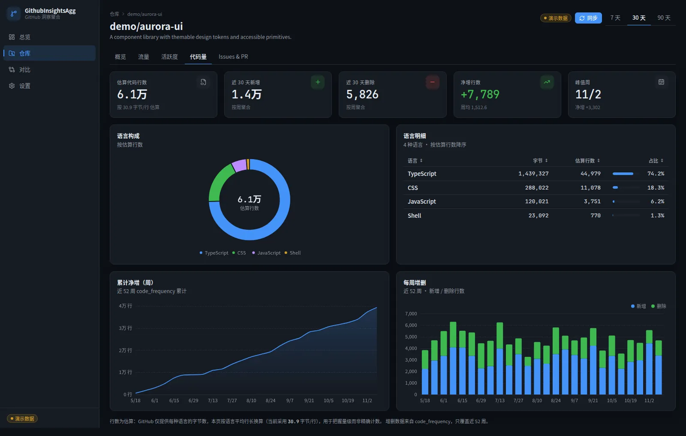
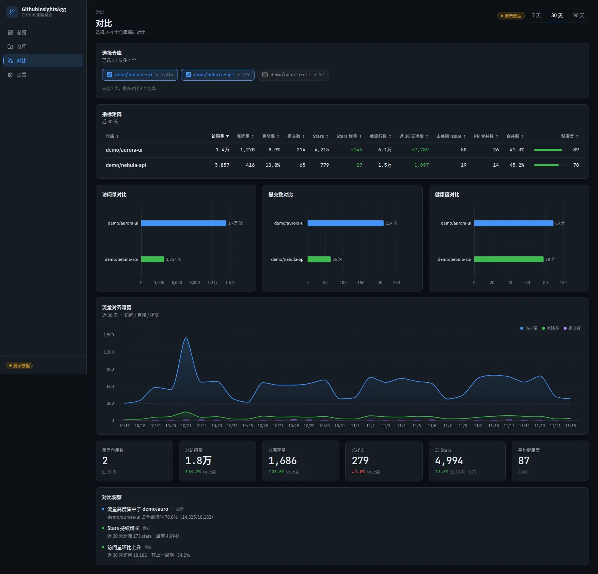
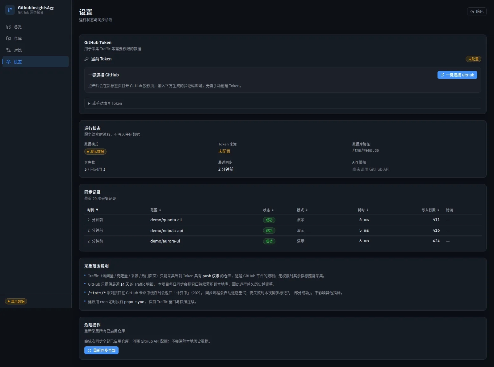

# GithubInsightsAgg

[English](README.md) | **简体中文**


把 GitHub 仓库 Insights 页面里分散的指标（Traffic、提交活跃度、Contributors、Issues、Community）统一采集落库，提供**跨仓库聚合**、**趋势对比**与**规则化中文洞察**的分析平台。

## 目录

1. [项目简介](#1-项目简介)
2. [功能特性](#2-功能特性)
3. [界面预览](#3-界面预览)
4. [快速开始](#4-快速开始)
5. [配置 GitHub Token](#5-配置-github-token)
6. [脚本](#6-脚本)
7. [页面导览](#7-页面导览)
8. [HTTP API](#8-http-api)
9. [数据采集矩阵](#9-数据采集矩阵)
10. [指标口径](#10-指标口径)
11. [架构说明](#11-架构说明)
12. [定时采集](#12-定时采集)
13. [已知限制](#13-已知限制)
14. [技术栈](#14-技术栈)
15. [许可证](#15-许可证)

## 1. 项目简介

GithubInsightsAgg 是一个**自建、单进程、单用户**的 GitHub 数据聚合分析平台。它解决 GitHub 原生 Insights 的四个关键短板：

- **Traffic 只有 14 天**：GitHub 只保留最近 14 天的 views / clones 明细，稍不留神就永久丢失。本项目每日同步把窗口持续落进本地 SQLite，运行越久历史越完整。
- **没有跨仓库视图**：原生 Insights 只能一个仓库一个仓库地看，无法比较「哪个仓库值得继续投入」。本项目提供聚合 KPI、排行榜、健康度评分与横向对比页。
- **没有历史留存**：Stars / Forks / Open Issues 只有当前值。本项目每日写快照，可以算区间增量。
- **只有裸图表没有结论**：本项目内置规则引擎，直接输出中文洞察与异常提示（如「克隆比例偏高，可能存在自动化同步或镜像」「近 30 天无访问记录」）。

数据落在本地 SQLite（`node:sqlite`，零 ORM），页面与 API 由同一个 Next.js 进程提供，无需额外服务。

## 2. 功能特性

### Traffic（访问与克隆）

- 逐日 `views` / `uniqueVisitors` / `clones` / `uniqueCloners`，支持 7 / 30 / 90 天区间。
- 来源排行（referrers）与热门页面（paths）。
- 克隆比例 `cloneRate`：识别镜像站、CI 拉取、自动化同步等异常。

### 代码活跃度

- 逐日提交曲线（来自 GitHub `stats/commit_activity`）。
- 周参与度：每周 commits / additions / deletions（`stats/participation` + `stats/code_frequency`）。
- 贡献者 Top 20（接口最多取前 100）与合计提交数。
- 最忙星期（`busiestWeekday`）与日均提交数（`avgCommitsPerDay`）。

### 代码量聚合统计（估算）

- 估算代码行数：把 `/languages` 的每种语言字节数按语言系数（`LANGUAGE_BYTES_PER_LINE`）换算成行数。
- 语言行数构成：按**估算行数**占比拆分（不是字节占比），并展示实际用到的加权字节/行，让估算依据可核查。
- 逐周增删与累计净增曲线：来自 `stats/code_frequency`（近 52 周）。
- 跨仓库代码规模对比：估算总行数、聚合语言构成与按规模排序的仓库榜。
- **行数为估算**：GitHub 不提供真实 LOC，详见下文第 10 节与 [`docs/CONTRACTS.md` §9](docs/CONTRACTS.md)。

### Issues / PR 健康度

- 逐日新开 / 关闭 Issue，新开 / 合并 / 关闭未合并 PR。
- 关闭率 `closeRate`、合并率 `mergeRate`、疑似积压 `staleOpenIssues`。
- 用于回答「需求在堆积还是在消化」。

### 仓库概览与社区健康

- Stars / Forks / Watchers / Open Issues 与区间增量 `starDelta`。
- Stars 等指标的每日快照趋势。
- 语言构成（按字节占比）。
- Release 节奏：最近发布列表 + 相邻发布间隔中位数 `releaseCadenceDays`。
- 社区健康档案：health percentage 与 README / LICENSE / CONTRIBUTING / CODE_OF_CONDUCT / Issue 模板 / PR 模板 / 描述 7 项清单。

### 多仓库聚合与对比

- 总览页聚合 KPI、按日汇总的趋势曲线、仓库排行榜、语言构成、跨仓洞察。
- 对比页支持 2~4 个仓库横向对比：指标矩阵、访问量 / 提交数 / 健康度对比图、流量对齐趋势、对比洞察。

### 规则化中文洞察

- 每个仓库与聚合视图都会生成最多 6 条洞察，按严重程度排序（critical > warn > info > good）。
- 覆盖：流量环比异动、克隆比例过高、来源集中、提交活跃度下滑、Issue 积压、社区档案缺失、Stars 增长、区间内零流量、代码规模收缩、技术栈单一、语言集中度高。

### 健康度评分

- 0~100 复合评分，由流量、活跃度、响应度、社区健康四部分加权得出，可排序、可对比。
- 聚合视图的 `overall.healthScore` 按各仓库 `views` 加权平均。

## 3. 界面预览

以下截图均来自真实运行的实例（演示数据、30 天区间），由 Playwright 在 1600 px 视口下整页截取。

### 总览

跨仓库 KPI、访问量 / 克隆量与提交趋势、仓库排行榜、语言构成、代码规模（估算）与规则化洞察。



### 仓库详情 · 概览

单个仓库的 Stars / Forks 趋势、语言构成、Release 节奏与社区健康清单。



### 仓库详情 · 流量

逐日访问量与克隆量、来源排行与热门页面。



### 仓库详情 · 活跃度

逐日提交曲线、星期分布、每周新增 / 删除行与贡献者排行。



### 仓库详情 · 代码量

按语言拆分的估算代码行数、逐周新增 / 删除与累计净增曲线。



### 多仓库对比

2~4 个仓库横向对比：指标矩阵、访问量 / 提交数 / 健康度对比图、流量对齐趋势与对比洞察。



### 设置与 Token

Token 来源与脱敏值、一键连接 GitHub（Device Flow）、手动填写入口，以及运行状态与同步记录诊断。



## 4. 快速开始

要求 Node.js >= 22.5（使用内置 `node:sqlite`），并已安装 pnpm。

```bash
pnpm install
cp .env.example .env
pnpm db:migrate
pnpm dev        # http://localhost:3000
```

启动后打开 <http://localhost:3000>。首次访问会在空库上自动自举演示数据。

**不配置 Token 时会自动进入演示模式**：库里会写入 3 个合成仓库（`demo/aurora-ui`、`demo/nebula-api`、`demo/quanta-cli`），规模分别是大流量高活跃、中等、冷清，因此排行榜、对比页、洞察都有真实可看的形态，界面完全可用。页面顶部的模式徽章会明确标注当前是 `demo` 还是 `live`。

演示数据是确定性生成的（同一仓库每次生成完全一致），不依赖网络。

注意：如果本机已经用 `gh auth login` 登录过，项目会自动沿用 `gh` 的 Token 进入 `live` 模式，此时**不会**自举演示仓库，需要到 `/repos` 页添加仓库，或执行 `pnpm sync --repo owner/name` 先落一个仓库。

## 5. 配置 GitHub Token

三种方式任选其一，推荐顺序自上而下。

### 5.1 应用内一键授权（推荐）

走 GitHub OAuth **Device Flow**，全程不需要复制 Token。

1. 在 GitHub 注册 OAuth App：**Settings → Developer settings → OAuth Apps → New OAuth App**（名字与主页随意填，回调地址 Device Flow 用不到）。
2. 在应用详情页勾选 **Enable Device Flow**。
3. 把 Client ID 写进 `.env` 并重启服务：

   ```bash
   GITHUB_OAUTH_CLIENT_ID="Iv1.xxxxxxxxxxxx"
   ```

   **只需 Client ID，不需要 Client Secret。**
4. 打开 `/settings`，点击「一键连接 GitHub」，把页面上的验证码填到自动打开的 GitHub 页面并同意授权。Token 会被校验、落库并立即生效，无需重启。

未配置 `GITHUB_OAUTH_CLIENT_ID` 时设置页会隐藏该按钮，自动降级为 5.2。

### 5.2 应用内手动粘贴

在 `/settings` 点击「去 GitHub 创建 Token」：链接已预填 `repo` 与 `read:org` 权限（不要改小，缺少 `repo` 就读不到 Traffic）。把 Token 粘贴到密码框并保存，系统会用 `GET /user` 校验、写入本地库并立即使用。

支持的 Token 类型：

- **fine-grained PAT**：选中要采集的仓库，至少给 `Metadata: Read-only`、`Contents: Read-only`、`Issues: Read-only`、`Pull requests: Read-only`；要读 Traffic 还需给 `Administration: Read-only`（Traffic 接口要求对该仓库有 push 权限）。
- **classic PAT**：勾选 `repo`（含私有仓库）或 `public_repo`（仅公开仓库）。

### 5.3 环境变量 / gh CLI

传统方式，适合 CI 与容器，在 `.env` 里填写：

```bash
GITHUB_TOKEN="ghp_xxx"
```

`GH_TOKEN` 与 `GITHUB_TOKEN` 等价；两者都没有时，会尝试读取本机已登录的 `gh` CLI（`gh auth token`）。

解析顺序固定为：`GITHUB_TOKEN` → `GH_TOKEN` → 应用内保存的 Token（`app_settings.github_token`）→ `gh auth token` → 演示模式。环境变量优先级最高，若想用设置页管理 Token，请把 `GITHUB_TOKEN` 留空。

**Traffic 的平台限制**：GitHub 只允许「对该仓库有 push 权限的 Token」读取 views / clones / referrers / paths。对只有读权限的他人仓库，Traffic 采集会失败，其余指标（提交、贡献者、Issue/PR、语言、Release、社区档案）照常采集，本次同步会被标记为「部分成功」。这不是本项目的缺陷，而是 GitHub 的接口限制。

**Token 存储**：设置页保存的 Token 以**明文**存放在本地 SQLite 的 `app_settings` 表中。只有服务端进程会读取它，任何 HTTP 响应都只返回掩码（如 `ghp_…ab12`），但请不要把 `data/` 目录拷贝或共享出去；共享机器上建议改用环境变量。

采集节流可调：`GITHUB_MIN_INTERVAL_MS`（默认 80ms）。

## 6. 脚本

| 命令 | 用途 | 示例 |
| --- | --- | --- |
| `pnpm dev` | 本地开发服务器（默认 3000 端口） | `pnpm dev` |
| `pnpm build` | 生产构建（含 TypeScript 类型检查） | `pnpm build` |
| `pnpm start` | 启动生产服务（需先 `pnpm build`） | `pnpm start` |
| `pnpm lint` | 类型检查（`tsc --noEmit`） | `pnpm lint` |
| `pnpm typecheck` | 类型检查（与 `pnpm lint` 同一条命令） | `pnpm typecheck` |
| `pnpm db:migrate` | 建库建表（幂等，可重复执行） | `pnpm db:migrate` |
| `pnpm sync` | 命令行采集，供 cron / CI 调用 | `pnpm sync --all --days 30`<br>`pnpm sync --repo owner/name`<br>`pnpm sync --repo owner/name --json` |
| `pnpm smoke` | 端到端自检（隔离库，CI 友好） | `pnpm smoke`<br>`pnpm smoke --url http://localhost:3000` |

### `pnpm sync` 参数

| 参数 | 说明 |
| --- | --- |
| `--repo <owner/name>` | 只同步该仓库；库中不存在时先创建占位行再同步（停用的仓库也会被同步） |
| `--days <n>` | 采集区间 7~90，默认 30 |
| `--all` | 同步所有 enabled 仓库（默认行为）；与 `--repo` 同时给出时 `--repo` 优先并打印 warning |
| `--json` | 以 JSON 输出（机器消费），内容含 `scope / days / mode / dbPath / warnings / results / summary` |
| `-h`, `--help` | 打印用法 |

默认输出为人类可读表格，每行给出 `status / recordsWritten / durationMs / error`，末尾打印汇总（`成功 N / 部分成功 M / 失败 K`）、`mode` 与数据库路径。

退出码：`0` = 全部成功或部分成功；`1` = 至少一个仓库失败（便于 cron 报警）；`2` = 参数非法。

### `pnpm smoke` 检查项

`pnpm smoke` 会先用一个**隔离数据库**跑完整链路，绝不触碰你的 `data/insights.db`：

1. 建表：14 张表齐全。
2. 自举：`ensureBootstrapped()` 返回 `{ seeded, mode }`，重复调用保持幂等。
3. 仓库：库中存在仓库。
4. 指标计算：单仓 30 天区间下 `traffic.daily` / `activity.commits` / `issues.daily` / `overview.statsTrend` 均为 30 个点，`healthScore` 落在 0~100，`insights` 为数组，且递归扫描无 `NaN` / `Infinity`。
5. 聚合：`overall.repos`、`trend.length`、`perRepo.length` 与仓库数一致。
6. 空集边界：`computeAggregate([], 30)` 不抛错且 `overall.repos === 0`。
7. HTTP（可选）：传 `--url` 时校验 `/api/health`、`/api/repos`、`/api/aggregate` 返回 200 且结构符合预期；不传则 `SKIP`。

每项打印 `PASS` / `FAIL` / `SKIP`，失败不中断，最后输出 `smoke: N passed, M failed, K skipped`。存在 FAIL 时退出码为 1。

## 7. 页面导览

| 路径 | 作用 |
| --- | --- |
| `/` | 总览：聚合 KPI、访问量 / 克隆量趋势、提交活跃度趋势、仓库排行、语言构成、代码规模（估算）与跨仓洞察；顶部可切换 7 / 30 / 90 天 |
| `/repos` | 仓库管理：仓库列表、添加（`owner/name`）、启用 / 停用、单仓同步、删除（级联清空关联数据）、最近同步记录 |
| `/repos/[owner]/[repo]` | 仓库详情，5 个 Tab：**概览**（Stars/Forks 趋势、语言、Release 节奏、社区健康清单）、**流量**（逐日访问与克隆、来源排行、热门页面）、**活跃度**（每日提交、周增删行、贡献者、最忙星期）、**代码量**（按语言拆分的估算行数、逐周增删、累计净增）、**Issues & PR**（逐日新开/关闭/合并、关闭率、合并率、积压）；支持区间切换与单仓重新同步 |
| `/compare` | 多仓对比：选择 2~4 个仓库，给出指标矩阵、访问量 / 提交数 / 健康度对比、流量对齐趋势与对比洞察；仓库不足时给出空态提示 |
| `/settings` | 配置与诊断：GitHub Token 面板（一键 Device Flow 授权、手动粘贴、清除 Token）、Token 来源与当前模式、数据库路径、最近 20 次同步记录、采集范围说明、重新同步全部仓库 |

## 8. HTTP API

统一约定：成功 `200` + JSON（`POST /api/repos` 新建仓库返回 `201`）；参数错误 `400`；资源不存在 `404`；冲突 `409`；服务端异常 `500` 且响应体为 `{ error, detail? }`。

| 方法 | 路径 | 用途 |
| --- | --- | --- |
| `GET` | `/api/health` | 健康检查与配置诊断：`ok`、`mode`、Token 状态与来源、仓库数、最近同步时间、数据库路径、限流余量 |
| `GET` | `/api/repos` | 仓库列表（按 `stars` 降序） |
| `POST` | `/api/repos` | 添加仓库，请求体 `{ "fullName": "owner/name" }`（也接受 `{ owner, name }`）；已存在返回 `409 { error: "repo_exists" }` |
| `PATCH` | `/api/repos/:id` | 启用 / 停用仓库，请求体 `{ enabled: boolean }`（缺失或非布尔值返回 `400 { error: "invalid_body" }`） |
| `DELETE` | `/api/repos/:id` | 删除仓库并级联清空全部关联数据 |
| `POST` | `/api/sync` | 触发采集，请求体 `{ fullName?, days? }`（`days` 默认 30，允许 7~90）；省略 `fullName` 时同步所有 enabled 仓库 |
| `GET` | `/api/sync` | 最近同步记录，支持 `?limit=20` |
| `GET` | `/api/metrics/:owner/:repo` | 单仓完整指标，支持 `?days=30`；仓库未入库返回 `404 { error: "repo_not_found" }`，从未同步则返回结构完整的零值指标 |
| `GET` | `/api/aggregate` | 多仓聚合指标，支持 `?days=30&repos=owner/a,owner/b`；`repos` 省略时取全部 enabled 仓库，空结果 `overall.repos = 0` |
| `GET` | `/api/auth/token` | 当前 Token 状态（绝不返回明文）：`configured`、`source`（`env` / `stored` / `gh-cli` / `none`）、`maskedToken`、`canClear`、`deviceFlowAvailable` 与 GitHub 相关链接 |
| `POST` | `/api/auth/token` | 保存粘贴的 Token：先 `GET /user` 校验，再落库，返回 `{ ok, login, scopes, maskedToken }`；无效 Token 返回 `400 { error: "invalid_token" }` |
| `DELETE` | `/api/auth/token` | 清除应用内保存的 Token（来自环境变量时 `409 { error: "token_from_env" }`，不存在时 `404 { error: "no_stored_token" }`） |
| `POST` | `/api/auth/device` | 发起 OAuth Device Flow：`{ deviceCode, userCode, verificationUri, expiresIn, interval }`；未配置 `GITHUB_OAUTH_CLIENT_ID` 返回 `501 { error: "device_flow_unavailable" }` |
| `GET` | `/api/auth/device` | 用 `?deviceCode=` 轮询授权状态，恒为 `200`，按 `state` 分发：`pending` / `slow_down` / `success` / `error` |

以上 14 个「方法 + 路径」组合对应 8 条路由，字段定义见 `docs/CONTRACTS.md` 第 6 节。

## 9. 数据采集矩阵

| Insights 模块 | GitHub 接口 | 落库表 | 配额 |
| --- | --- | --- | --- |
| 仓库基础信息 | `GET /repos/{o}/{r}` + GraphQL 计数（open issues / open PRs / watchers） | `repos` | 2 |
| Stars/Forks 趋势 | 同上（每日快照） | `repo_stat_snapshots` | 0（本地快照） |
| 访问量 / 克隆 | `GET /repos/{o}/{r}/traffic/views` + `/clones` | `traffic_daily` | 2 |
| 来源排行 | `GET .../traffic/popular/referrers` | `traffic_referrers` | 1 |
| 热门页面 | `GET .../traffic/popular/paths` | `traffic_paths` | 1 |
| 提交频率 | `GET .../stats/commit_activity` | `commit_days` | 1 |
| 周参与度（增删行） | `GET .../stats/participation` + `/stats/code_frequency` | `participation_weeks` | 2 |
| 贡献者 | `GET .../contributors?per_page=100` | `contributors` | 1 |
| Issues / PR 健康度 | GraphQL 最近 100 条 issues/PR | `issue_pr_daily` | 1 |
| 语言构成 | `GET .../languages` | `repo_languages` | 1 |
| Release 节奏 | `GET .../releases?per_page=30` | `releases` | 1 |
| 社区健康档案 | `GET .../community/profile` | `community_profiles` | 1 |

单仓每次全量同步共 14 次请求（12 次 REST + 2 次 GraphQL）；REST 的 5000/h 配额可覆盖约 400 次全量同步。

## 10. 指标口径

所有日期对外统一为 `YYYY-MM-DD`（UTC），所有比例字段为 `0~1` 的小数，百分比格式化只在前端做。

- `cloneRate = clones / max(1, views)`（`views = 0` 时取 0）
- `avgCommitsPerDay = totalCommits / days`
- `closeRate = issuesClosed / max(1, issuesOpened)`
- `mergeRate = prMerged / max(1, prOpened + prMerged)`
- `staleOpenIssues = max(0, openIssues - issuesClosed)`
- `starDelta = 区间末 stars - 区间初 stars`（无历史快照时取 0）
- `releaseCadenceDays`：按 `publishedAt` 倒序相邻间隔的中位数，样本 < 2 → `null`
- `busiestWeekday`：`activity.commits` 按周几聚合求和最大的中文星期，无数据 → `null`

`healthScore`（0~100）：

```text
traffic        = min(100, 100 * log1p(views) / log1p(5000))
activity       = min(100, 100 * avgCommitsPerDay / 3)
responsiveness = round(mergeRate * 60 + max(0, 1 - min(1, avgCloseHours / 336)) * 40)
community      = community?.healthPercentage ?? 50

healthScore = round(0.30*traffic + 0.30*activity + 0.20*responsiveness + 0.20*community)
```

其中 `avgCloseHours` 无法获得时按 168 处理；聚合视图的 `overall.healthScore` 为各仓库 `healthScore` 按 `views` 加权平均（全部 `views` 为 0 时取算术平均）。

### 代码量（估算）

行数全部是**估算值**：GitHub 只提供每种语言的字节数（`/languages`）与每周增删（`stats/code_frequency`），不提供真实 LOC。

- `lines = round(bytes / bytesPerLine(language))`，`bytesPerLine` 取自 `LANGUAGE_BYTES_PER_LINE`（34 项，未命中回退 34 字节/行）
- `bytesPerLine`（加权）= `sum(bytes) / max(1, sum(lines))`，保留 1 位小数，并在 UI 上展示以透明化估算依据
- `byLanguage[].percent` 是**估算行数**占比，不是字节占比（字节占比见 `overview.languages[].percent`），两者不可混用
- `weekly[]`：`net = additions - deletions`，`cumulative` 沿 `weekStart` 滚动累加；该序列**不按 `days` 截断**（代码量是存量指标）
- `last30d` 只保留 `weekStart >= today - (days - 1)` 的周（周粒度窗口，边界周整周计入）
- `avgWeeklyNet` 固定取最近 52 周平均，与 `days` 无关
- `peakWeek` 取 `|net|` 最大的周
- 聚合页：`estimatedLines` 求和，`byLanguage` 按语言合并后重算 `percent`，`weekly` 按 `weekStart` 并集求和，`perRepo` 按 `estimatedLines` 降序

完整系数表与单仓 / 聚合的逐条口径见 [`docs/CONTRACTS.md` §9](docs/CONTRACTS.md)。

## 11. 架构说明

```text
GithubInsightsAgg/
├── src/
│   ├── app/          App Router：页面（总览 / 仓库 / 详情 / 对比 / 设置）与 REST API 路由
│   ├── components/   UI 基础组件、图表封装、页面区块（客户端交互唯一入口）
│   └── lib/          服务端核心：GitHub 客户端与采集器、写库、读库聚合、派生指标（含代码量估算）、洞察规则
├── db/               schema.sql（14 张表的唯一事实来源）
├── scripts/          运维脚本：db:migrate / sync（cron 采集）/ smoke（端到端自检）
├── docs/             设计与契约文档（PLAN、CONTRACTS、CONTRACTS-ADDENDUM）
├── data/             SQLite 数据库文件（默认 insights.db，随 .gitignore 忽略）
└── 根配置            package.json、tsconfig.json、next.config.ts、postcss.config.mjs、.env.example
```

数据流（自上而下单向，不在页面里做计算）：

```text
GitHub REST v3 / GraphQL v4
        ↓  src/lib/github（client：重试 / 限流 / 节流；collectors：traffic / activity / issues / overview）
  src/lib/sync.ts（编排：逐组 try/catch，单组失败 → partial）
        ↓
  src/lib/sync-store.ts（参数化 SQL，upsert / replace 两类语义，写 run 记录）
        ↓
  SQLite（node:sqlite）· 14 张表
        ↓
  src/lib/metrics-store.ts（只读，按区间查表；代码量曲线另读 `participation_weeks` 全量历史）
        ↓
  src/lib/analytics.ts（派生指标 + healthScore + 代码量估算）→ src/lib/insights.ts（规则引擎，中文洞察）
        ↓
  Server Component 页面 / REST API（/api/*）
```

演示模式不是「读取时替换数据」：同步阶段就把合成数据写进同一批表，因此读库、指标、页面三条链路完全共用一套代码，`mode` 只用于响应标记与 UI 提示。

## 12. 定时采集

项目不自带调度器，用系统 cron 调用 `pnpm sync` 即可：

```cron
# 每天 03:00 采集所有已启用仓库的近 30 天窗口
0 3 * * * cd /srv/GithubInsightsAgg && /bin/bash -lc 'pnpm sync --all --days 30' >> /srv/GithubInsightsAgg/logs/sync.log 2>&1
```

要点：

- cron 的 `PATH` 很精简，用 `/bin/bash -lc '...'`（或改用 pnpm 绝对路径）才能加载 nvm / corepack 配置。
- `logs/` 目录需提前创建，日志会持续追加。
- 退出码可用于报警：`0` 表示全部成功或部分成功，`1` 表示至少一个仓库失败，`2` 表示参数非法。也可以配 `MAILTO` 让 cron 在非零退出时发邮件。
- 想让日志更适合机器解析时改用 `pnpm sync --all --json`，输出为单个 JSON 对象。
- 采集频率建议每天 1 次：Traffic 只有 14 天窗口，日更足以保证不丢数据，同时节省配额。

## 13. 已知限制

- **Traffic 仅 14 天**：GitHub 只提供最近 14 天明细，历史靠每日同步累积，首次使用看不到更早的数据。
- **Traffic 需要 push 权限**：只读 Token 无法采集他人仓库的 views / clones，本次同步会标记为「部分成功」。
- **contributors 取前 100**：`/contributors?per_page=100` 只取一页，超大仓库的贡献者总数会偏小。
- **Issue / PR 基于最近 100 条**：GraphQL 一次拉最近 100 条 issues 与 100 条 PR 在本地按日聚合，更早的历史不会进入 `issue_pr_daily`。
- **`/stats/*` 可能「计算中」**：GitHub 未命中缓存时返回 202 + 空 body，采集会退避重试，仍失败则该组标记跳过，本次同步为 partial。
- **行数为估算，且偏差方向不固定**：统一的字节/行系数会把压缩 / 生成产物（超长行）的行数**高估**，而系数表未登记、平均行更短的语言回退 34 字节/行时又会被**低估**。只能用于横向比较量级，不能当作精确 LOC。
- **`code_frequency` 仅覆盖近 52 周且常返回 202**：GitHub 缓存未命中时返回 202 + 空 body，该组被跳过、这些周缺失，因此 `cumulative` 是相对 52 周的曲线，而不是仓库真实总行数。
- **无 `avgCloseHours` 时按 168 小时估算**：响应度评分因此是近似值。
- **本机 `gh` 已登录时不会进演示模式**：Token 解析链会拿到 `gh auth token`，此时空库不会自举演示仓库。
- **单用户、无鉴权**：没有账号体系与多用户隔离，请勿直接暴露到公网。
- **无内置调度器**：需要 cron 或外部调度器调用 `pnpm sync`。
- **不做 GitHub App 安装流**：Token 只来自 PAT、OAuth Device Flow（`GITHUB_OAUTH_CLIENT_ID`）或 `gh` CLI，没有按安装授权的 App Token。
- **无 AI 摘要**：洞察全部来自规则引擎，二期才考虑模型摘要（接口位置已预留）。
- **Open Issues 口径**：优先用 GraphQL `issues(states: OPEN){ totalCount }`（不含 PR）；GraphQL 不可用时回退 REST 的 `open_issues_count`（含 PR，会偏大）。

## 14. 技术栈

| 层 | 选型 |
| --- | --- |
| 框架 | Next.js 16.4.6（App Router，Server Component 直连数据库） |
| UI | React 19.3.1 + TypeScript 5.9（`^5.9.0`）+ Tailwind CSS 4.3.5 |
| 图表 | ECharts 6.1.0（按需注册 + 自建薄封装） |
| 存储 | `node:sqlite`（Node 内置 `DatabaseSync`，零 ORM、零原生编译，要求 Node >= 22.5） |
| 数据源 | GitHub REST v3（Traffic / stats）+ GraphQL v4（Issues / PR / watchers） |
| 包管理 | pnpm |

## 15. 许可证

MIT，见 [LICENSE](LICENSE)。
